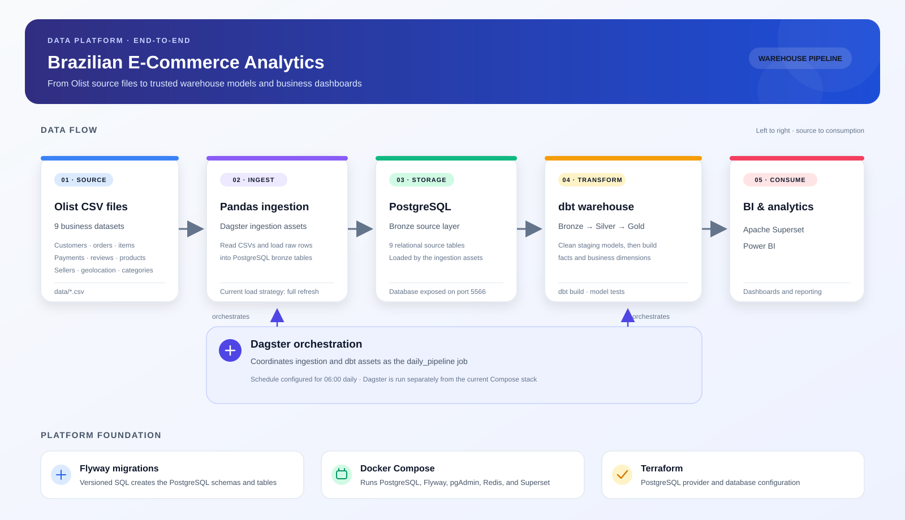

# Brazilian E-Commerce Data Platform

An end-to-end analytics project built around the public Olist Brazilian e-commerce dataset. It loads CSV source data into PostgreSQL, transforms it into analytics-ready models with dbt, orchestrates the pipeline with Dagster, and exposes the results through BI tools.

## Architecture



## End-to-end data flow

1. **Source data** — The `data/` directory contains nine CSV files covering customers, geolocation, order items, payments, reviews, orders, products, sellers, and English product-category translations.
2. **Orchestration** — Dagster declares the CSV source assets and corresponding ingestion assets. The `daily_pipeline` job runs the ingestion assets followed by the dbt assets; a Dagster schedule is configured for 06:00 daily.
3. **Ingestion and raw storage** — Each ingestion asset reads its CSV with pandas and loads rows into a PostgreSQL `bronze` table. The current implementation truncates each target table before inserting the full file, so each run is a full refresh rather than an incremental load.
4. **Database setup** — Flyway applies the SQL scripts in `database_schema/` to create the database tables. The migration history creates the initial public tables and later adds the `bronze` schema and tables.
5. **Transformation** — dbt reads the bronze tables as sources, creates staging models in the `silver` schema, and builds dimensional and fact models in `gold`. The models include `fact_orders`, `fact_order_items`, and dimensions for orders, products, payments, reviews, geolocation, and dates. dbt tests are defined alongside model metadata.
6. **Analytics** — Apache Superset is included in the Docker Compose stack for dashboarding. A Power BI report is also present at [Dashboard/Olist_Dashboard.pbix](Dashboard/Olist_Dashboard.pbix).

## Technology

- **Orchestration:** Dagster and `dagster-dbt`
- **Storage:** PostgreSQL
- **Schema migrations:** Flyway
- **Transformations and tests:** dbt Core with the PostgreSQL adapter
- **BI:** Apache Superset and Power BI
- **Infrastructure configuration:** Docker Compose and Terraform

## Run locally

### 1. Start the database and supporting services

From the repository root:

```shell
docker compose up -d
```

The Compose file starts PostgreSQL, Flyway, pgAdmin, Redis, and Superset. The mapped web interfaces are pgAdmin at `http://localhost:8088` and Superset at `http://localhost:8089`; PostgreSQL is exposed on port `5566`.

### 2. Check database and schema configuration

The checked-in configuration currently uses different database names in different components:

- Flyway in `docker-compose.yml` targets `OlistBronze`.
- Terraform in `terraform/` creates `Olist`.
- Dagster ingestion connects to `Olist` and writes into the `bronze` schema.
- dbt reads from `Olist.bronze` as configured in `ecommerce/models/staging/sources.yml`.

Before running the pipeline, align the Flyway target database with the database used by ingestion and dbt, and ensure the migrations have completed successfully there. The credentials and connection settings in the local configuration should also be set for your environment; do not commit secrets.

### 3. Install Python dependencies

Use Python 3.11 or compatible with the project's dependencies. In a virtual environment:

```shell
python -m pip install -r requirements.txt
```

### 4. Configure dbt

Dagster loads the dbt project from `ecommerce/` and looks for the dbt profile in `~/.dbt`. Create `~/.dbt/profiles.yml` with an `ecommerce` profile that connects to the configured PostgreSQL database and has access to the bronze source schema.

### 5. Launch Dagster

From the repository root, start the Dagster development server:

```shell
dagster dev -m dagster_project.definitions
```

Materialize the ingestion assets and dbt assets, or launch the `daily_pipeline` job. The schedule in `dagster_project/definitions.py` is configured for 06:00 daily.

> **Deployment note:** `Dockerfile` builds an image containing the project dependencies and source code, but the current `docker-compose.yml` does not define a Dagster service. Run Dagster separately as above or add an orchestration service as part of a deployment.

## Repository map

| Path | Purpose |
|---|---|
| `data/` | Olist CSV source datasets |
| `dagster_project/` | Dagster definitions, source assets, ingestion assets, and dbt integration |
| `database_schema/` | Ordered Flyway SQL migrations |
| `ecommerce/models/staging/` | dbt staging models and bronze source declarations |
| `ecommerce/models/marts/` | dbt gold dimensions and fact models |
| `Dashboard/` | Power BI report |
| `docker-compose.yml`, `docker/` | Local PostgreSQL, Flyway, pgAdmin, Redis, and Superset configuration |
| `terraform/` | PostgreSQL provider and database configuration |
| `Assets/` | Project architecture and supporting images |

## Notes

- The Dagster schedule is defined in code; the Compose stack does not start Dagster or the Dagster daemon.
- Ingestion currently connects to PostgreSQL using local connection settings in `dagster_project/assets/ingestion.py`. Configure these for your environment before running.
